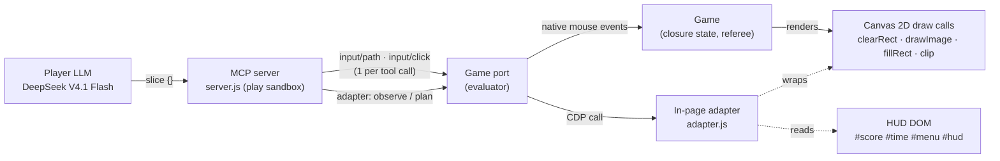

# How DeepSeek built and used its Fruit Ninja MCP

A demo mechanism analysis of the Phase 1 self-built MCP. It is not a benchmark: one builder
session and one MCP round on one seed. Nothing was rerun for this report. Every number comes
from recorded artifacts, listed under [Sources](#sources). Statements are marked
**observed** (read directly from traces, code or game events) or **inference** (our
interpretation of that evidence).

## At a glance

- **Built in one session.** In 146 turns and 29 minutes, DeepSeek V4.1 Flash read the
  shipped game, probed it through its own render-hook adapter, and wrote a Node MCP server
  plus an in-page adapter. It debugged them with practice rounds, froze four versions (all
  smoke-passing) and handed off `c34c30da`.
- **The MCP sees the game through its renderer.**
  - Fruit are reconstructed from Canvas 2D `drawImage` calls and bombs from a distinctive
    `fillRect`.
  - Velocities come from a least-squares ballistic fit that uses the game's own gravity.
  - Strokes are planned in the page as greedy multi-fruit chains that clear bombs.
- **The LLM mostly chose _when_, not _where_.** In the English-UI run the player model made
  48 `slice` calls, all with empty arguments. The MCP selected every target and every path
  point.
- **1268 points = 636 slice points + 632 combo bonus.** All 48 strokes sliced at least 3
  fruit, so each earned a combo bonus. The 20-slice frenzy started at 6.8 s and never
  lapsed, which doubled points and fruit supply and removed bombs. The MCP sliced 328 of
  the 346 fruit spawned.
- **Integrity:** only rendered or visible information and native input through the game
  port were used. The referee recorded no violations, and all 328 slices were attributed to
  host-executed strokes.
- **Two incidental findings:**
  - The MCP's latency self-calibration never ran at play time, because of a reply-format
    difference between the build-time and play-time ports.
  - On the English UI, `game_state.mode` is `null`, because the adapter matched Chinese mode
    labels. Neither affected play.

## 1. Discovery: 146 turns in 29 minutes

Times are session time from the builder's `tools.jsonl`; quotes are from the model's own
`reasoning_content` in `llm.jsonl` (observed).

| Time        | Turns   | What happened                                                                                                                                                                                                                                                                                                                                                                                                                                                                                                          |
| ----------- | ------- | ---------------------------------------------------------------------------------------------------------------------------------------------------------------------------------------------------------------------------------------------------------------------------------------------------------------------------------------------------------------------------------------------------------------------------------------------------------------------------------------------------------------------- |
| 00:00–01:17 | 1–15    | **Read the black box.** It read the manifest, `CONTRACT.md` and `PORT.md`, then the whole 855-line game in chunks, then the public port, executor, lockdown and dev-port sources. Turn 11 (28 s of reasoning, 26k characters) summarized the mechanics: the 120 Hz wall-clock pump, the prepare hook, start by native click only. Turn 15/16: "`fillRect` during play is only in drawBomb".                                                                                                                            |
| 01:20–02:46 | 16–42   | **Probe the live page.** It wrote a `probe-adapter.js` that dumps draw calls, a dev-port start script and a port client (`pc.mjs`). It mapped the canvas ("1362x817 at (39, 92). dpr=1"), found the start button, and a native click at (230, 554) was accepted. Turn 36 fixed a wrong `drawImage` argument index.                                                                                                                                                                                                     |
| 04:10–05:17 | 43–64   | **Write the MCP.** It wrote `mcp/adapter.js` (14.8 KB, after 81 s of reasoning), read the MCP SDK's `registerTool` API, then wrote `server.js`, `launch.sh` and the manifest. Two sandbox hurdles came up: no `python3` (it switched to Node patch scripts) and `/output` not executable (it ran a copy from `/work`). All four tools listed.                                                                                                                                                                          |
| 05:58–24:10 | 65–117  | **Test and tune with practice rounds.** Stroke-level diagnostics (`test3`–`test8`) compared planned points with fruit positions. Turn 85: the ms/s unit bug. Turn 89: "the velocity fit returns velocity at the _start_ of the sample window". Turn 97: "the executor's CDP latency (~40 ms/move) stretches short paths", which led to a minimum segment time. Turns 101–106: a calibration script and a lead/step sweep, then adaptive calibration. Full rounds: arcade 1284, classic 340 with no bomb hits, zen 342. |
| 24:11–29:13 | 118–146 | **Freeze, smoke, hand off.** It froze and smoked v1. A final validation round scored 1323, and it wrote `NOTES.md` before reviewing its own code. v2, v3 and v4 followed, with handoff at 29:13.                                                                                                                                                                                                                                                                                                                       |

Discoveries that shaped the design (observed in `intermediate/NOTES.md` and the reasoning):

- **Game knowledge from the shipped source:**
  - gravity `g = H × 1.03`, which the predictor reuses;
  - fruit airborne for about 2.4 s;
  - waves every 1.48–1.82 s, or 0.64 s in frenzy;
  - bombs launched at the left and right edges with `vx = 0`;
  - hit test `distance ≤ r × 1.02`, or `r × 0.83` for bombs;
  - scoring rules and the 0.34 s combo gap.
- **Render signatures:** 320×320 sprites are fruit, draws under a clip are sliced halves, the
  bomb fuse is a `fillRect` with aspect ratio 0.43 : 0.26, and `clearRect` marks a frame.
- **Executor latency:** each native mouse move is a CDP round trip (about 40 ms). Segments
  shorter than that are stretched, so the blade arrives late.

### The four frozen versions

| Version       | Frozen | `adapter.js` / `server.js` | Change from previous                                                                                                                                                                                                                                                                                 |
| ------------- | ------ | -------------------------- | ---------------------------------------------------------------------------------------------------------------------------------------------------------------------------------------------------------------------------------------------------------------------------------------------------- |
| v1 `22ea1861` | 24:11  | 15,868 / 9,812 B           | First complete MCP: four tools, smoke pass                                                                                                                                                                                                                                                           |
| v2 `59beab51` | 27:20  | 16,206 / 9,812 B           | Handles the 9-argument `drawImage` form. When a path exceeds 1000 ms it sheds the tail instead of compressing time, which could break the speed cap. A single-target stroke now moves along the fruit's motion. Fruit wait raised from 1.7 s to 2.5 s. `NOTES.md` added, six experiment files pruned |
| v3 `6f1052a1` | 28:56  | 16,206 / 10,367 B          | `slice` presses the start button if the round has not started; README updated                                                                                                                                                                                                                        |
| v4 `c34c30da` | 29:04  | 16,206 / 10,472 B          | `slice` description documents that behaviour. **Handed off at 29:13**                                                                                                                                                                                                                                |

All four versions expose the same tools (`game_state`, `start_round`, `slice`,
`slice_fruit`). The core observation, tracking and planning logic was settled before v1;
later versions only hardened edge cases (observed from the diffs).

## 2. Implementation

Inside one `slice` call: **frames** (draw calls) → **tracks** (nearest-neighbour) →
**least-squares ballistic fit** → **predict** → **greedy chain with an intercept-time solve
and bomb clearance** → **finalize** (page pixels, speed cap, 1 s limit) → **one native path**
→ **observe again**.

The code references below are to the handed-off files in
[`evidence/phase1/pilot-1/handoff/mcp/`](../evidence/phase1/pilot-1/handoff/mcp/).

**Observation** ([adapter.js:62–103](../evidence/phase1/pilot-1/handoff/mcp/adapter.js#L62-L103)).
The game's state is in a closure, so the adapter rebuilds it from rendering, which the
contract allows.

- **Frames:** each `clearRect` closes the previous frame and opens a new one while the menu is
  hidden.
- **Fruit:** a `drawImage` of a 320×320 sprite outside a clip is a fruit. The current
  transform gives its centre `(m.e, m.f)` and `dw × 124/320` its radius.
- **Bombs:** a `fillRect` whose `w/h` equals 0.43/0.26 is a bomb's fuse cap, and `w/0.43` is
  its radius.
- **HUD:** score, timer, lives, phase and start-button position come from DOM ids
  ([202–240](../evidence/phase1/pilot-1/handoff/mcp/adapter.js#L202-L240)).

**Object tracking** ([111–139](../evidence/phase1/pilot-1/handoff/mcp/adapter.js#L111-L139),
[179–198](../evidence/phase1/pilot-1/handoff/mcp/adapter.js#L179-L198)). Greedy
nearest-neighbour matching against the previous frame with a 170 px gate keeps up to 26
samples per track. Unmatched detections start new tracks, and tracks that stop being drawn
(sliced or gone) are dropped at once.

**Velocity estimation** ([141–161](../evidence/phase1/pilot-1/handoff/mcp/adapter.js#L141-L161)).
A least-squares fit of `x = x0 + vx·t` and `y = y0 + vy·t + ½g·t²` uses the game's own
`g = H × 1.03`. The fit's velocity refers to the oldest sample, so `processFrame` propagates
it to the newest one (`vy + g·span`). This was the bug fixed at turn 89.

**Trajectory prediction** ([292–296](../evidence/phase1/pilot-1/handoff/mcp/adapter.js#L292-L296)).
A ballistic extrapolation from the newest sample to an absolute page time.

**Bomb avoidance** ([298–316](../evidence/phase1/pilot-1/handoff/mcp/adapter.js#L298-L316)).
Each candidate blade segment is sampled every 12 px. At each sample's time, the predicted
bomb position must stay farther away than the game's bomb hit radius `0.83·r` plus a 26 px
margin. A target whose segment fails is skipped.

**Path planning** (`plan`, [356–444](../evidence/phase1/pilot-1/handoff/mcp/adapter.js#L356-L444)):

1. Start `lead` ms in the future and keep fruit predicted to be on screen.
2. Pick the first target nearest the bottom centre, then repeatedly pick the nearest unused
   fruit.
3. Solve each arrival time by fixed-point iteration: `t = t_prev + max(step, distance /
speed)` at 3200 px/s.
4. Stop when the chain would exceed 900 ms.

The path visits each fruit's predicted position at its predicted time.
`finalizePath` ([322–354](../evidence/phase1/pilot-1/handoff/mcp/adapter.js#L322-L354)) then:

- maps to page pixels and clamps to the canvas;
- makes times strictly increasing;
- enforces 4800 px/s, inside the port's 5000;
- sheds tail points beyond 1000 ms.

**Native input execution**
([server.js:61–68](../evidence/phase1/pilot-1/handoff/mcp/server.js#L61-L68),
[156–193](../evidence/phase1/pilot-1/handoff/mcp/server.js#L156-L193)). `stroke()` works as
follows:

1. Observe.
2. If the menu is up, spend the call's single input on the start button.
3. Otherwise plan, retrying every 50 ms for up to 2.5 s while there are no fruit.
4. Send exactly **one** blocking `POST /v1/input/path`, wait 60 ms, and observe again.

Tool calls are serialized so two inputs never race the port's one-active-path rule
([113–120](../evidence/phase1/pilot-1/handoff/mcp/server.js#L113-L120)).

**Latency calibration**
([server.js:81–90](../evidence/phase1/pilot-1/handoff/mcp/server.js#L81-L90),
[146–154](../evidence/phase1/pilot-1/handoff/mcp/server.js#L146-L154)). `step` (minimum
segment time) and `lead` start at 70 and 80 ms. After each stroke they are meant to track the
measured per-segment overrun: `step ← 0.75·step + 0.25·overrun` and `lead = step + RTT + 10`.

- **Observed:** this never activated at play time. The build-time dev port reports a
  blocking path's time in `previous_action.actual_duration_ms`; the play-time port reports
  it as a top-level `actual_duration_ms` and leaves `previous_action` null. The MCP reads the
  former ([server.js:179](../evidence/phase1/pilot-1/handoff/mcp/server.js#L179)), so every
  plan in both the Phase 1 and English runs used 70/80 ms.
- **Inference:** that cost little. The builder's own sweep found 70/70 (412) and 80/60 (400)
  to be the best settings, both close to 70/80.

**Tools exposed:**

| Tool          | Implementation                  | Note                                                                                                                         |
| ------------- | ------------------------------- | ---------------------------------------------------------------------------------------------------------------------------- |
| `game_state`  | `observe`                       | Read-only; returns tracked fruit and bombs with velocities                                                                   |
| `start_round` | native click on `#start-button` |                                                                                                                              |
| `slice`       | `stroke()` with auto-planning   | Optional knobs: duration, speed, bomb margin, wait                                                                           |
| `slice_fruit` | `stroke()` with `target_id`     | The description says it "continues through any other fruit along the way", but `plan` keeps only the target (adapter.js:376) |

## 3. Actual gameplay: who decided what

**Observed in the English-UI rerun**
(`cf519a1`, seed 42, 60 s; `artifacts/showcase-english/run/mcp`):

- **The LLM's 51 calls:** `game_state`, `start_round`, `slice` ×48 (always `{}`) and a
  final `game_state`.
- **Its reasoning:** 452 reasoning tokens in total, for example "Sliced 3 fruits, gained 6
  points. Let me continue slicing", and a median of 0.39 s between calls.
- **Behind those 48 calls the MCP made** 100 `observe` calls, 98 `plan` calls (50 of them
  `no-fruits` retries) and 48 native paths. It chose every target and point.

The LLM's decisions were: read the state, start the round, choose the auto-planning `slice`
tool over `slice_fruit`, keep calling it, and stop at `phase: result`.

Five representative strokes are shown below. Plan data comes from the port log, slices from
the referee's events, and "gained" is the score difference the tool returned.

| #   | Game time | Plan                     | Planned → executed | Referee slices | Gained |
| --- | --------- | ------------------------ | ------------------ | -------------- | ------ |
| 1   | 0.84 s    | 3 fruit, 3 points        | 140 → 219 ms       | 3 × 1 pt       | +6     |
| 4   | 5.16 s    | 5 fruit, 2 bombs visible | 280 → 391 ms       | 5 × 1 pt       | +10    |
| 13  | 15.61 s   | 10 fruit, 10 points      | 671 → 871 ms       | 10 × 2 pt      | +40    |
| 30  | 36.39 s   | 9 fruit                  | 675 → 799 ms       | **12** × 2 pt  | +48    |
| 45  | 55.41 s   | 10 fruit                 | 837 → 1004 ms      | **5** × 2 pt   | +20    |

- **#1, the first stroke.** Fruit were already visible, so there was no wait. The chain swept
  right to left through three fruit, (695, 490) → (484, 419) → (269, 462). All three were
  sliced within 142 ms of each other, so the stroke earned a 3-fruit combo: 3 + 3 bonus.
- **#4, bombs on screen.** Before frenzy the plan saw 2 bombs. The executed blade samples
  stayed **≥ 645 px** from the nearest bomb hit circle (referee telemetry). Bombs launch at
  the arena edges while waves rise near the centre, so the safety check was not the binding
  constraint (inference). The tool's "gained" of 10 includes the combo bonus.
- **#13, frenzy.** Ten fruit in one 671 ms chain: right through a cluster, then a turn back
  left through a second group. All ten were sliced within 0.7 s, so 20 slice points plus a
  20-point bonus.
- **#30, more than planned.** The straight segments between planned fruit crossed four
  unplanned ones, while one planned target was missed. The referee recorded 12 slices for 9
  targets, the largest single gain. (Adapter track IDs and referee object IDs are
  independent counters that both count in order of appearance, so this match is
  approximate.)
- **#45, late targets missed.** The chain ran from the right edge up to (988, 368) and then
  down to the canvas bottom (y ≈ 908). It executed 167 ms longer than planned. The early
  fruit were sliced, but most of the falling fruit near the bottom edge were missed. This
  points to accumulated timing error on long, downward chains (inference).

Across all 48 strokes the plan held a mean of **6.9 targets** (3 to 13). The executed path
sliced **3 to 12** fruit, 328 in total for 331 planned targets. Execution ran a mean of 157 ms
longer than planned (461 → 618 ms), about 25 ms per segment.

## 4. Why the English-UI MCP run scored 1268

**Observed** (English rerun, compared with the GUI rerun on the same seed and the Phase 1
MCP run):

|                                  |           MCP (English) |          GUI (English) | MCP (Phase 1) |
| -------------------------------- | ----------------------: | ---------------------: | ------------: |
| Score                            |                    1268 |                     16 |          1268 |
| Slices × points                  |  20 × 1 + 308 × 2 = 636 |            16 × 1 = 16 |           636 |
| Combo bonus                      |                     632 |                      0 |           632 |
| Frenzy active                    |       6.8–60 s (53.2 s) | never (16 < 20 slices) |     6.83–60 s |
| Fruit spawned / sliced / escaped |          346 / 328 / 12 |         158 / 16 / 138 | 346 / 328 / 8 |
| Strokes (native paths)           | 48, all with ≥ 3 slices |               19 drags |            50 |
| Blade moving                     |          29.6 s of 60 s |                        |               |
| Median model reply               |                  0.39 s |                 1.82 s |        0.37 s |

Further observations:

- **Frenzy saturated the round.** Under the game rule (`sliced ≥ 20 + 20k` → `frenzy = 6`),
  the 20th slice at 6.8 s started frenzy. Each later block of 20 slices arrived within 6 s,
  so it never lapsed. All 328 slice point values match these rule-derived windows.
- **Frenzy doubled supply and removed bombs.** Fruit spawned at 3.13/s before frenzy and
  6.12/s during it. Frenzy clears bombs and blocks new ones; no bomb was visible after
  6.75 s.
- **Idle waiting disappeared.** `no-fruits` retries happened only before strokes 2–6, about
  0.3–0.9 s each. After frenzy every plan found fruit immediately.
- **Combos are near-automatic.** Each chain slices its fruit well within the 0.34 s combo
  gap, so the bonus (632) almost equals the slice points (636).
- **The cycle was about 1.2 s per stroke.** The `slice` tool took 0.80 s (median) and the
  model 0.39 s between calls.
- **The builder's own scripted loop,** with no LLM in the loop and about 86–89 strokes,
  scored 1282–1323 in arcade. The LLM-driven run made 48 strokes and scored 1268.

**Inference: why it works.**

- **The roles:** structured observation removes the perception step, and internal planning
  turns each call into a 3–13-fruit chain with near-certain combos. Together they push
  slicing above 20 fruit per 6 s.
- **The feedback loop:** that rate keeps frenzy on permanently. Frenzy doubles both points
  and bonus, doubles the fruit supply, and removes bombs and idle waits, so the next strokes
  have even more to slice.
- **The cap is supply, not stroke count:** the MCP sliced 95% of spawned fruit. That is why
  86–89 builder-loop strokes and 48 LLM-driven strokes give similar scores, and why the English
  and Phase 1 runs (different stroke counts and escapes) both scored exactly 1268. With a
  seeded spawn schedule and a deterministic planner, the outcome is largely fixed once
  frenzy is reached.
- **Why the GUI could not get there:** it never sliced 20 fruit, so it played the entire
  round at the base spawn rate, without combos and with bombs present.

**Not established** by one round: how much of the gap comes from observation versus planning
versus speed. No ablation was run, and this report does not claim one.

## 5. Integrity (brief)

| Check                    | Result (observed)                                                                                                                                                                                                                                   |
| ------------------------ | --------------------------------------------------------------------------------------------------------------------------------------------------------------------------------------------------------------------------------------------------- |
| Information used         | Canvas 2D draw calls (explicitly allowed), HUD DOM text and attributes, and knowledge of the shipped source. No referee, seed, future spawns or hidden state; these are unreachable in the hardened page.                                           |
| Side effects in the page | The adapter only wraps Canvas 2D methods and reads the DOM. No event dispatch, DOM/CSS writes, timers or network (code inspection).                                                                                                                 |
| Server                   | Uses only the port socket. No filesystem, network or child processes (code inspection).                                                                                                                                                             |
| Input                    | Every stroke is one native path via `/v1/input/path`, and the start is one native click. The port rejected 0 requests. The referee attributed 328/328 slices to host-executed strokes. There were no integrity violations, and lockdown was active. |
| Planning                 | Target selection inside the MCP is allowed by the contract (one input per call). It is an interpretive caveat for MCP-vs-GUI comparisons, not an integrity issue.                                                                                   |

The English rerun used `cf519a1`, which includes the later pointer-integrity hardening
(`687ec0b`). The same frozen MCP produced the same 1268 there, consistent with it relying
only on native input.

## 6. Technical conclusions

1. **Mechanism discovery** came from reading the shipped JavaScript rather than probing
   blindly. The physics constants, render signatures and hit radii it found map directly
   onto the tracker, predictor and bomb check.
2. **Debugging was empirical.** Comparing planned points with tracked positions stroke by
   stroke exposed a unit bug, a velocity-reference bug and executor latency. Each fix is
   visible in the code and recorded in `NOTES.md`.
3. **The MCP is an autopilot behind a one-input-per-call interface.** In play the LLM chose
   tools and pacing; the MCP chose every target and path. This is the main point to make
   explicit when comparing it with a GUI agent.
4. **Performance is dominated by a game-rule feedback loop** (frenzy) that the planner
   reaches within 7 s and never leaves. Fruit supply, not stroke count or LLM speed, is the
   limit in this run.
5. **Small findings for future rounds:**
   - Make the dev port's and play port's path replies identical (latency calibration was
     silently inactive).
   - Fix the `slice_fruit` description.
   - Note that `mode` reads `null` on the English UI.
   - Long downward chains lose late targets.
   - Bomb avoidance was barely exercised on this seed.

## Sources

- **Builder session:** `artifacts/phase1/pilot-1/builder/` (local mirror of
  `reef:~/fruit-ninja-mcp-phase1/4d7fde3/artifacts/phase1/pilot-1/builder/`), containing
  `tools.jsonl`, `llm.jsonl` and `frozen/` with the four versions. Builder commit `4d7fde3`.
- **Handed-off MCP:** [`evidence/phase1/pilot-1/handoff/`](../evidence/phase1/pilot-1/handoff/),
  including the builder's [`intermediate/NOTES.md`](../evidence/phase1/pilot-1/handoff/intermediate/NOTES.md).
- **English-UI rerun:** `artifacts/showcase-english/run/{mcp,gui}/` (mirror of
  `reef:~/fruit-ninja-mcp-phase1/cf519a1/artifacts/showcase-english/run/`), at commit `cf519a1`:
  `port.jsonl`, `actor/{tools,llm}.jsonl`, `events.json`, `game/{trace,timeline}.jsonl`,
  `result.json` and the recordings.
- **Phase 1 MCP and GUI run:** `artifacts/phase1/pilot-1/{mcp,gui}/`; summary in
  [PHASE1-PILOT.md](PHASE1-PILOT.md).
- **Game rules:** the pinned upstream source (`sliceEntity`, `finishStroke`, `spawnWave`).
  Large artifacts are not committed, because the game is unlicensed; see
  [NOTICE](../NOTICE.md).
